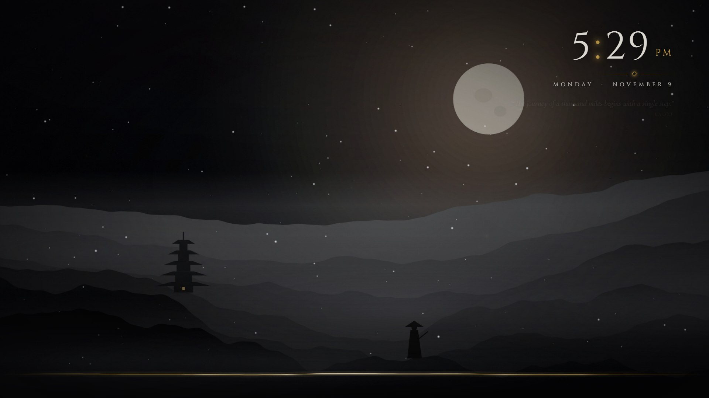

# Ronin

**A free, open-source live wallpaper for Windows that does more and uses far less than a wallpaper engine.**

Snow, rain, mist and gold embers over your own art. A carved-serif clock, rotating proverbs, an ink line that moves with your music, and task boards you can click right on the desktop. It runs in one small process that drops to 0 % CPU whenever a window covers it.



**[Download the latest version](https://github.com/HikaYoru/ronin-wallpaper/releases/latest)** · **[Website](https://hikayoru.github.io/ronin-wallpaper/)**

---

## Why Ronin instead of a wallpaper engine?

| | **Ronin** | Typical wallpaper engine |
|---|---|---|
| Price | **Free, public domain** | Paid, or free with a store / account |
| Memory while animating | **~47 MB** (Task Manager) | ~355–430 MB for the same wallpaper as a web page in Wallpaper Engine |
| CPU while animating | **~1.4 %** at 60 fps | ~5 % or more for web wallpapers |
| Processes | **1** | 5–7 (browser-based renderers) |
| When a game or app is fullscreen | Stops drawing and stops listening to audio: **0 % CPU** | Varies; often needs configuring |
| Account / Steam / store | **None** | Often required |
| Install | Unzip and run. .NET is included | Installer + store client |
| Desktop to-do list you can click | **Yes**: boards, sections, statuses, notes, sub-tasks | No |
| Wallpaper across several monitors as one scene | **Yes**: panorama, and weather that drifts across the bezels | Usually one wallpaper per screen |
| Source code | **All of it, do whatever you like with it** | Closed |

*Measured on a 1920×1080 280 Hz monitor with an RTX 4060, November 2026. Your numbers will vary, but the gap stays big. The native renderer draws with Direct2D on the GPU instead of running a whole web browser.*

## Features

### The scene
- **Weather**: snow, rain, drifting mist, gold embers and lightning. Or turn on **real local weather** (Open-Meteo, no API key needed) and it matches the sky outside.
- **Time-of-day lighting**: dawn, day, dusk and night tint the scene and its glow.
- **Music ink line**: a gold line along the bottom that follows whatever is playing (any app, any output device), with automatic gain so it moves at any volume.
- **Now playing**: track and artist from Spotify, browsers, media players. Album art as an optional widget.
- **Your own backgrounds**: images, **animated GIFs** and **looping videos** (`.mp4 .mov .mkv .webm …`). **Drag them from Explorer onto the Settings window** (or click *Add files…*), pick from a thumbnail gallery, and see them in a **live preview** of the real wallpaper before you choose.
- Film grain, vignette, slow "breathing" zoom and parallax.

### On the desktop
- **Clock, date and rotating proverbs** in Cinzel / Cormorant Garamond / Shippori Mincho.
- **Clickable task boards**: one board per project, with section headers that fold, three-state tasks (not started / in progress / done), notes and sub-tasks. Click a task right on the wallpaper to open it. Clicks only reach the wallpaper on empty desktop, never on icons or windows.
- **Task HUD**: press **Ctrl+Alt+T** for a sticky note of your tasks over everything.
- **Widgets**: calendar (any `.ics` link from Google, Outlook or iCloud), CPU / GPU / memory sparklines, a focus timer you click on the desktop, world clocks, album art.

### Make it yours
- **Arrange mode**: drag the clock, quote, tasks and widgets where you want them, with live preview, snapping, alignment guides, resizing from the corners, undo, and drag-to-another-monitor.
- **Saved layouts**, switched by hand or **on a schedule** (e.g. a work layout on weekdays at 9:00).
- **Every setting per monitor**, plus **monitor roles**: Main (clock and tasks), Side (agenda, world clocks, album, system), Ambient (just the scene).
- **Panorama**: one wide image across all your monitors, using their real positions so it lines up.
- Import / export all settings as one file.

### Light on your PC
- **Native renderer**: Direct2D / DirectComposition on its own render thread, one GPU device per graphics card.
- **Pauses itself** on any monitor covered by a maximized or fullscreen app, and drops the other monitors to 15 fps while you game.
- Frame-rate cap (30 / 60 / match display) and a lower cap for side monitors.
- Stable across driver updates, Explorer restarts and monitors being plugged in and out.

### Bonuses
- **Auto-updates** from this GitHub page (tray → *Install update*). Your settings and images are kept.
- **Also works inside Wallpaper Engine and Lively Wallpaper**: `ronin-wallpaper/` is a standard web wallpaper with `project.json` and `LivelyInfo.json`, if you'd rather use those.
- **Matching themes** in `ronin-themes/`: Windows Terminal, Spotify (Spicetify), Windhawk taskbar and Start menu, and Windows accent colours.
- A second **web renderer** (the original HTML page in WebView2) if you want to tinker with the wallpaper in HTML / CSS / JS.

## Install

1. Download `Ronin-x.y.z.zip` from **[Releases](https://github.com/HikaYoru/ronin-wallpaper/releases/latest)**.
2. Unzip it somewhere permanent (e.g. `Documents\Ronin`).
3. Run **`Start Ronin.cmd`**. Windows may show *"Windows protected your PC"* because the app isn't code-signed: click **More info → Run anyway**.
4. Find the gold diamond in the system tray. Left-click for settings, right-click for everything else. Tick **Start with Windows** if you want it to start when you log in.

**Needs:** Windows 10 (2004+) or 11, 64-bit, and the Microsoft Edge WebView2 Runtime (already on Windows 11) for the settings window.

## Build from source

You need the [.NET 8 SDK](https://dotnet.microsoft.com/download/dotnet/8.0).

```powershell
cd ronin-host
dotnet run                       # run it
..\tools\publish.ps1 -Public     # make a shareable zip in releases\public
```

`ronin-host/README.md` explains how everything works, file by file.

## Project layout

| Folder | What's in it |
|---|---|
| `ronin-host/` | The Windows app (C#, .NET 8, WinForms + Direct2D via Vortice) |
| `ronin-wallpaper/` | The wallpaper as a web page, its settings schema and background images |
| `ronin-themes/` | Matching themes for other apps |
| `tools/` | `publish.ps1` (build a release) and `install.ps1` (install one locally) |
| `docs/` | The website (GitHub Pages) |

## License

**Public domain** ([The Unlicense](LICENSE)). Use it, change it, sell it, re-release it under your own name. No credit needed.

The bundled fonts are under the SIL Open Font License (`ronin-host/fonts/OFL-*.txt`), which also allows free use and redistribution. The default background, `ink-mountains.jpg`, was made for this project and is public domain too.
